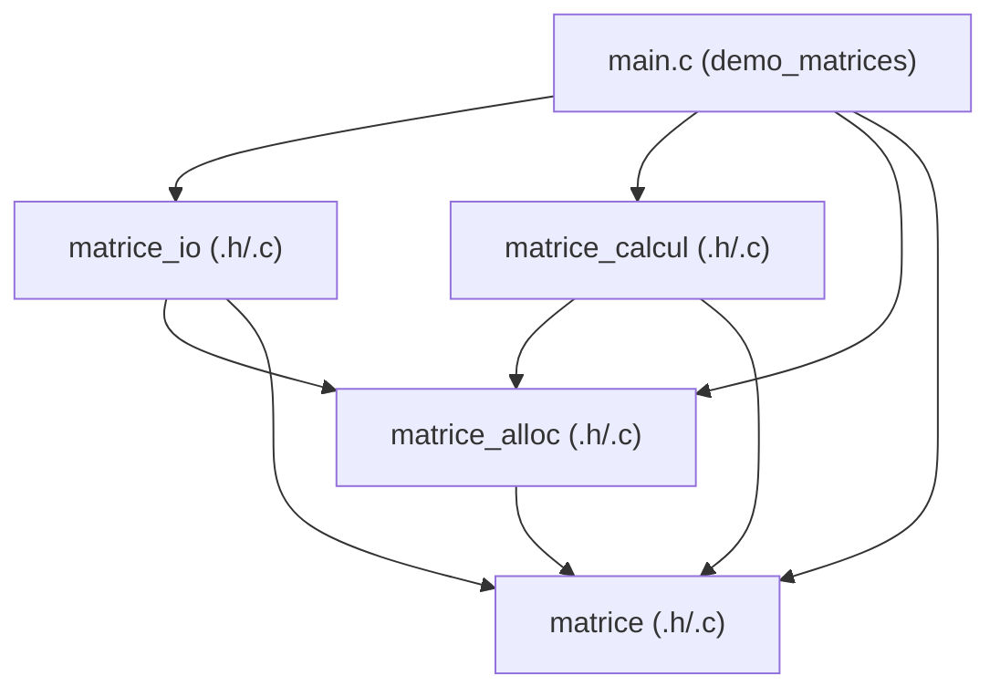
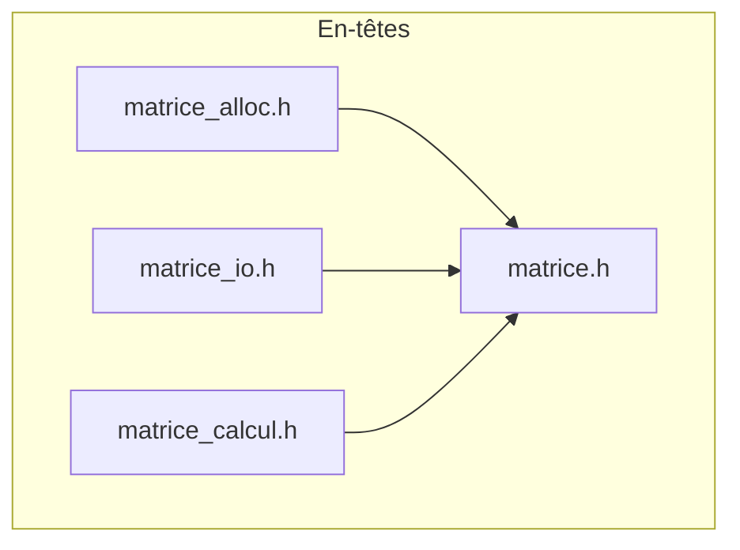

# TD — Stockage de matrices en C

**INSA Centre Val de Loire — 3e année STI (FISE) — Programmation C**  
*Responsable : A. ADELL*

---

## En-tête

- **Groupe :** TD1
- **Binôme / Trinôme :**
  - **LUONG Minh Hieu** (GitHub : [`MinHieu2006`](https://github.com/MinHieu2006))
  - **TIENOU ULRICH Brayanne** (GitHub : [`Tienou`](https://github.com/Tienou))
  - **Abdoulaye NIANG** (GitHub : [`niangablaye546-cmd`](https://github.com/niangablaye546-cmd))
- **Dépôt :** [https://github.com/MinHieu2006/Project_Programming_C](https://github.com/MinHieu2006/Project_Programming_C)
- **Date de remise :** 2 novembre 2026 (Tag : `rendu`)

---

## Table des matières

1. [Introduction](#1-introduction)
2. [Conception](#2-conception)
3. [Réalisation et tests](#3-réalisation-et-tests)
4. [Questions de réflexion](#4-questions-de-réflexion)
5. [Vérifications mémoire (Valgrind)](#5-vérifications-mémoire-valgrind)
6. [Démonstration finale](#6-démonstration-finale)
7. [Bilan et répartition du travail](#7-bilan-et-répartition-du-travail)

---

## 1. Introduction

Ce projet a pour objectif la conception et l'implémentation d'une bibliothèque modulaire en langage C pour la manipulation de matrices rectangulaires d'entiers (`int`), accompagnée d'un programme de démonstration applicatif nommé `demo_matrices`.

Les objectifs pédagogiques abordés sont :
- La séparation stricte entre interfaces (`.h`) et implémentations (`.c`).
- L'allocation dynamique bidimensionnelle et la maîtrise de la propriété mémoire pour garantir l'absence totale de fuites.
- La lecture et l'écriture fiables dans des fichiers texte (avec le principe « tolérant en lecture, strict en écriture »).
- Le calcul matriciel (addition et multiplication) avec contrôle rigoureux des dimensions et détection des dépassements de capacité entière (`INT_MAX` / `INT_MIN`).
- La compilation séparée et l'automatisation de la chaîne de compilation avec `make`.

**État à la remise :**  
Tous les exercices (1 à 4) sont **complets, testés et 100 % fonctionnels**. Les trois suites de tests fournies réussissent intégralement (16/16, 14/14, 14/14), aucune fuite mémoire n'est présente sous Valgrind (cas nominaux comme cas d'erreur), et la compilation sous `gcc -std=c11 -Wall -Wextra -Wpedantic` ne produit aucun avertissement.

---

## 2. Conception

### 2.1 Organisation des modules

Le projet est découpé en quatre modules métier et un module applicatif :

| Module | Fichiers | Rôle principal |
|---|---|---|
| **Matrice de base** | `matrice.h`, `matrice.c` | Définition du type `Matrice`, constante `MATRICE_VIDE`, codes d'erreur `MatErreur`, utilitaires `mat_est_valide`, `mat_message_erreur`. |
| **Allocation** | `matrice_alloc.h`, `matrice_alloc.c` | Création (`mat_allouer`) et libération sécurisée (`mat_detruire`) de la mémoire heap. |
| **Entrées-Sorties** | `matrice_io.h`, `matrice_io.c` | Affichage (`mat_afficher`), écriture formatée (`mat_ecrire`) et lecture robuste (`mat_lire`). |
| **Calcul** | `matrice_calcul.h`, `matrice_calcul.c` | Opérations arithmétiques (`mat_additionner`, `mat_multiplier`) avec détection de débordement. |
| **Application** | `main.c` (`demo_matrices`) | Point d'entrée utilisateur : validation des arguments, orchestration lecture $\to$ calcul $\to$ écriture, affichage des messages d'erreur. |



### 2.2 Graphe des inclusions et rôle de `#ifndef`

Chaque fichier `.h` définit une interface publique et utilise des directives de préprocesseur pour former une **garde d'inclusion** (par exemple `#ifndef MATRICE_H`, `#define MATRICE_H`, `#endif`).



- **Nécessité des gardes :** `matrice.h` définit le type `Matrice`. Sans les gardes `#ifndef`, inclure à la fois `matrice_io.h` et `matrice_calcul.h` dans `main.c` entraînerait une double inclusion de `matrice.h`, ce qui provoquerait une erreur de redéfinition du type `struct matrice` à la compilation.
- **Principe de contrat :** Aucun fichier `.h` fourni n'a été modifié, préservant ainsi l'intégrité du contrat d'interface.

### 2.3 Règles de propriété mémoire (R1 à R7)

Le projet respecte rigoureusement les règles de gestion mémoire définies dans le sujet :
- **R1 (Initialisation sûre) :** Toute variable locale `Matrice` est initialisée à `MATRICE_VIDE` (`{ NULL, 0, 0 }`).
- **R2 (Propriétaire unique) :** Chaque matrice allouée a un propriétaire clairement identifié. On ne pratique jamais de copie superficielle par simple affectation (`b = a`).
- **R3 (Sortie propre en cas d'erreur) :** Si une fonction échoue (`mat_allouer`, `mat_lire`, `mat_additionner`, `mat_multiplier`), elle laisse le paramètre de sortie `*res` à l'état `MATRICE_VIDE` sans fuite.
- **R4 (Libération partielle) :** Dans `mat_allouer`, si la $k$-ième allocation d'une ligne échoue, les $k$ lignes déjà obtenues sont immédiatement libérées avant de libérer le tableau de pointeurs.
- **R5 (Immutabilité des entrées) :** Les fonctions de calcul et d'écriture reçoivent des pointeurs constants `const Matrice *` et ne modifient jamais les matrices d'entrée.
- **R6 (État post-destruction) :** `mat_detruire(&m)` remet systématiquement la matrice à `MATRICE_VIDE`, rendant un double appel à `mat_detruire` inoffensif.
- **R7 (Fermeture des flux) :** La fonction ou le module qui ouvre un flux avec `fopen` (`main.c`) a la charge exclusive de le fermer avec `fclose`.

### 2.4 Choix techniques et masquage

- **Encapsulation (`static`) :** Les fonctions auxiliaires internes (`lire_entier` dans `matrice_io.c`, `verifier_parametres` et `tient_dans_int` dans `matrice_calcul.c`, `charger` et `sauvegarder` dans `main.c`) sont qualifiées `static` pour limiter leur portée à leur unité de traduction.
- **Contrôle des débordements :** Les calculs intermédiaires (produits et sommes) sont effectués en type `long long` avec détection anticipée de dépassement avant d'être affectés dans un `int`.
- **Point de sortie unique :** Dans `main.c`, la gestion des erreurs utilise une étiquette `nettoyage:` vers laquelle sautent les cas d'échec (`goto nettoyage`), garantissant que les matrices allouées (`a`, `b`, `r`) sont systématiquement détruites une et une seule fois.

---

## 3. Réalisation et tests

### 3.1 Compilation avec Makefile

Le projet se compile avec `gcc` et les drapeaux stricts `-std=c11 -Wall -Wextra -Wpedantic -g`.

```sh
make            # Compile et exécute test_ex1, test_ex2, test_ex3, puis compile demo_matrices
make clean      # Nettoie les fichiers objets et les exécutables
```

### 3.2 Résultats des tests unitaires

#### Exercice 1 : Allocation et destruction (`test_ex1`)
```text
=== Exercice 1 : matrice.c ===
[OK]    (1.a) message pour MAT_ERR_DIMENSIONS
[OK]    (1.a) message pour MAT_ERR_DEPASSEMENT
[OK]    (1.b) une matrice 1 x 2 est valide
[OK]    (1.b) NULL n'est pas valide
[OK]    (1.b) MATRICE_VIDE n'est pas valide
[OK]    (1.b) une matrice de 0 ligne n'est pas valide
=== Exercice 1 : matrice_alloc.c ===
[OK]    (1.c) mat_allouer refuse 0 ligne
[OK]    (1.c) mat_allouer refuse -2 colonnes
[OK]    (1.c) mat_allouer refuse une dimension > MAT_DIM_MAX
[OK]    (1.e) mat_allouer(&m, 3, 4) renvoie MAT_OK
[OK]    (1.e) m a 3 lignes et 4 colonnes
[OK]    (1.d) tous les coefficients valent 0
[OK]    (1.f) apres mat_detruire, m est vide
[OK]    (1.f) un second mat_detruire est sans danger
[OK]    (1.f) mat_detruire(NULL) ne plante pas
=== Exercice 1 : echecs d'allocation simules ===
[OK]    (1.d) chaque echec renvoie MAT_ERR_ALLOCATION et laisse *res vide

Bilan : 16 / 16 verifications reussies.
```

#### Exercice 2 : Entrées-sorties (`test_ex2`)
```text
=== Exercice 2 : affichage (verification visuelle) ===
M (4 x 3) :
        1        2        3
        4        5        6
        7        8        9
       10       11       12
(2.a) Vous devez voir ci-dessus 4 lignes : 1 2 3 / 4 5 6 / 7 8 9 / 10 11 12
=== Exercice 2 : ecriture ===
[OK]    ouverture de test_ex2_sortie.txt en ecriture
[OK]    (2.b) mat_ecrire renvoie MAT_OK
[OK]    (2.b) le fichier contient exactement le format attendu
[OK]    (2.b) mat_ecrire refuse une matrice vide
=== Exercice 2 : relecture ===
[OK]    (2.f) mat_lire relit le fichier : MAT_OK
[OK]    (2.e) la matrice relue est identique
[OK]    (2.e) espaces et sauts de ligne en trop sont toleres
=== Exercice 2 : fichiers incorrects ===
[OK]    (2.c) fichier vide
[OK]    (2.c) dimension nulle
[OK]    (2.c) dimension negative
[OK]    (2.e) coefficient manquant
[OK]    (2.e) donnee non numerique
[OK]    (2.e) entier trop grand pour un int
=== Exercice 2 : echec d'allocation simule ===
[OK]    (2.d) mat_lire renvoie MAT_ERR_ALLOCATION proprement

Bilan : 14 / 14 verifications reussies.
```

#### Exercice 3 : Calcul matriciel (`test_ex3`)
```text
=== Exercice 3 : addition ===
[OK]    (3.a) (2 x 3) + (3 x 2) : MAT_ERR_DIMENSIONS
[OK]    (3.d) (2 x 3) + (2 x 3) : MAT_OK
[OK]    (3.c) a + b est correct
[OK]    a et b n'ont pas ete modifiees
[OK]    (3.b) le resultat possede sa propre memoire
[OK]    (3.c) INT_MAX + 1 : MAT_ERR_DEPASSEMENT
=== Exercice 3 : multiplication ===
[OK]    (3.e) (2 x 3) x (2 x 3) : MAT_ERR_DIMENSIONS
[OK]    (3.h) (2 x 3) x (3 x 2) : MAT_OK
[OK]    (3.g) a x c = (58 64 / 139 154)
[OK]    (3.f) (3 x 2) x (2 x 3) donne une matrice 3 x 3
[OK]    a et c n'ont pas ete modifiees
[OK]    (3.g) 2 x 10^10 depasse INT_MAX : MAT_ERR_DEPASSEMENT
=== Exercice 3 : cas particuliers ===
[OK]    resultat = entree refuse, a reste intacte
[OK]    (3.f) echec d'allocation : MAT_ERR_ALLOCATION, r vide

Bilan : 14 / 14 verifications reussies.
```

---

## 4. Questions de réflexion

### Exercice 1 — Allocation et destruction

- **Q3.1 (Pointeur pour `mat_detruire`) :** `mat_detruire` prend un pointeur `Matrice *` pour pouvoir modifier directement la variable de l'appelant. Si on passait par valeur, la fonction travaillerait sur une copie locale : la mémoire du tas serait bien libérée, mais la structure de départ ne serait pas remise à `MATRICE_VIDE` et contiendrait des pointeurs pendants.
- **Q3.2 (Nombre d'appels `calloc` et `free`) :** Pour une matrice $n \times p$, il faut $1 + n$ appels à `calloc` (1 pour le tableau de pointeurs et $n$ pour les lignes), et autant d'appels à `free` pour la libération totale. Si la $k$-ième allocation de ligne échoue, il faut libérer les $k$ lignes déjà allouées plus le tableau de pointeurs, soit $k + 1$ appels à `free`.
- **Q3.3 (Double destruction et copie) :** Deux appels successifs à `mat_detruire` sur la même matrice sont sans danger car `mat_detruire` assigne `*m = MATRICE_VIDE` à la fin (donc `coef` devient `NULL`). Le second appel est ignoré grâce au test `if (m->coef != NULL)`. En revanche, avec `Matrice b = a;`, `a` et `b` partagent le même tableau de pointeurs : appeler `mat_detruire(&a)` puis `mat_detruire(&b)` provoque un double `free` sur la même adresse mémoire (comportement indéfini).
- **Q3.4 (Initialisation à `MATRICE_VIDE`) :** `mat_allouer` commence par `*res = MATRICE_VIDE` afin que `*res` soit dans un état cohérent et sécurisé immédiatement. Si la fonction échoue ensuite sur le test des dimensions ou lors d'une allocation, l'appelant peut appeler `mat_detruire(res)` sans risquer de comportement indéfini.

### Exercice 2 — Entrées-sorties

- **Q4.1 (Matrice locale dans `mat_lire`) :** Pour ne pas polluer `*res` avec des données partielles si la lecture échoue en cours de fichier (fichier tronqué ou mal formé). En cas d'erreur, on détruit la matrice locale `tmp` et `*res` reste `MATRICE_VIDE`. On ne transfère le résultat dans `*res` que si toute la lecture a abouti.
- **Q4.2 (Format et principe de lecture) :** Non, la lecture ne vérifie pas la disposition ligne par ligne car `fscanf` avec `%31s` ignore indistinctement les espaces, tabulations et retours à la ligne. Cela illustre le principe « tolérant en lecture, strict en écriture » : la bibliothèque accepte des données avec des espacements variés pour faciliter l'interopérabilité, mais génère des fichiers parfaitement canoniques lors de l'écriture.
- **Q4.3 (Deux matrices dans un même fichier) :** Comme `mat_lire` s'arrête exactement après la lecture du dernier coefficient, le curseur du flux `f` reste positionné sur la suite du fichier. Il suffit d'appeler une seconde fois `mat_lire(f, &m2)` sur le même flux pour lire la deuxième matrice séquentiellement.
- **Q4.4 (Rôle de `fflush` et `fclose`) :** `mat_ecrire` appelle `fflush` pour forcer le vidage du tampon applicatif vers le système d'exploitation et détecter immédiatement d'éventuelles erreurs d'écriture (par exemple un disque plein). Cela ne dispense pas de vérifier `fclose`, car la fermeture du flux libère les ressources noyau et peut également échouer.

### Exercice 3 — Calcul matriciel

- **Q5.1 (Utilisation de `const`) :** `const Matrice *a` protège uniquement les champs directs de la structure (on ne peut pas modifier `a->nb_lignes` ou réassigner le pointeur `a->coef`). Cependant, il n'empêche pas de modifier la valeur d'un coefficient via `a->coef[0][0] = 7;`. Pour interdire cela au niveau du compilateur, il faudrait déclarer les coefficients en `const int * const *coef;`.
- **Q5.2 (Résultat identique à une entrée) :** On interdit l'alias `mat_additionner(&a, &b, &a)` car la fonction initialise immédiatement `*res` à `MATRICE_VIDE`. Si `res` pointait vers `a`, on écraserait les pointeurs et les données de `a` avant de commencer les calculs, provoquant une corruption de données et une fuite mémoire.
- **Q5.3 (Nombre de multiplications) :** Pour multiplier une matrice $n \times p$ par une matrice $p \times q$, on calcule $n \times q$ coefficients, chacun nécessitant $p$ multiplications, soit un total de $n \times p \times q$ multiplications. Pour deux matrices $1000 \times 1000$, cela représente $1000^3 = 10^9$ (un milliard) de multiplications.
- **Q5.4 (Dépassement d'entiers) :** Calculer directement `int s = a + b` puis tester `s < a` est incorrect car le dépassement sur un entier signé est un comportement indéfini en C (le compilateur peut optimiser et supprimer le test). De plus, ce test est faux lorsque les nombres sont négatifs. Il faut effectuer le calcul dans un type plus large (`long long`), contrôler que la valeur se situe dans `[INT_MIN, INT_MAX]`, puis convertir vers `int`.

### Exercice 4 — Démonstration complète

- **Q6.1 (Affichage des erreurs) :** `mat_lire` appartient à une bibliothèque réutilisable : elle se contente de renvoyer un code d'erreur `MatErreur` sans imposer de message sur la sortie standard. C'est au programme applicatif (`main.c`) de décider comment notifier l'utilisateur (console, boîte de dialogue graphique, journal de logs).
- **Q6.2 (Vérification de `fclose`) :** Dans `sauvegarder`, `fclose` réalise l'écriture physique finale des derniers octets du tampon : son contrôle est impératif pour garantir que le fichier est intègre. Dans `charger`, les données ont déjà été lues en mémoire avec succès, une erreur lors de la fermeture ne remet pas en cause les données déjà acquises.
- **Q6.3 (Libération des matrices) :** Si l'enregistrement échoue après le calcul, il faut libérer 3 matrices : `a`, `b` et `r`. Grâce au bloc `nettoyage:` en fin de `main.c`, `mat_detruire` est appelé systématiquement sur les trois matrices, empêchant toute fuite de mémoire.

---

## 5. Vérifications mémoire (Valgrind)

Toutes les cibles ont été testées sous Valgrind (`valgrind --leak-check=full`).

### 5.1 Résumé Valgrind sur les programmes de test

```text
== test_ex1 ==
==14101== HEAP SUMMARY:
==14101==     in use at exit: 0 bytes in 0 blocks
==14101==   total heap usage: 227 allocs, 227 frees, 20,448 bytes allocated
==14101== All heap blocks were freed -- no leaks are possible
==14101== ERROR SUMMARY: 0 errors from 0 contexts

== test_ex2 ==
==14102== HEAP SUMMARY:
==14102==     in use at exit: 0 bytes in 0 blocks
==14102==   total heap usage: 104 allocs, 104 frees, 15,312 bytes allocated
==14102== All heap blocks were freed -- no leaks are possible
==14102== ERROR SUMMARY: 0 errors from 0 contexts

== test_ex3 ==
==14103== HEAP SUMMARY:
==14103==     in use at exit: 0 bytes in 0 blocks
==14103==   total heap usage: 78 allocs, 78 frees, 9,840 bytes allocated
==14103== All heap blocks were freed -- no leaks are possible
==14103== ERROR SUMMARY: 0 errors from 0 contexts
```

### 5.2 Valgrind sur `demo_matrices` (Cas nominal et Cas d'erreur)

- **Cas nominal (Multiplication $A \times C$) :**
```text
==14201== Command: ./demo_matrices mul donnees/A.txt donnees/C.txt R.txt
==14201== HEAP SUMMARY:
==14201==     in use at exit: 0 bytes in 0 blocks
==14201==   total heap usage: 22 allocs, 22 frees, 8,624 bytes allocated
==14201== All heap blocks were freed -- no leaks are possible
==14201== ERROR SUMMARY: 0 errors from 0 contexts
```

- **Cas d'erreur (Dimensions incompatibles $A + C$) :**
```text
==14202== Command: ./demo_matrices add donnees/A.txt donnees/C.txt R.txt
==14202== HEAP SUMMARY:
==14202==     in use at exit: 0 bytes in 0 blocks
==14202==   total heap usage: 14 allocs, 14 frees, 4,496 bytes allocated
==14202== All heap blocks were freed -- no leaks are possible
==14202== ERROR SUMMARY: 0 errors from 0 contexts
```

---

## 6. Démonstration finale

Exemples d'exécution du programme `demo_matrices` couvrant des scénarios nominaux et des cas d'erreur :

### Scénario 1 : Addition de deux matrices compatibles ($A + B$)
```text
$ ./demo_matrices add donnees/A.txt donnees/B.txt R.txt
A (4 x 3) :
       25       48       84
       15       33       11
       45       88       10
        0       12       -5
B (4 x 3) :
        1        2        3
        4        5        6
        7        8        9
       10       11       12
R = A + B (4 x 3) :
       26       50       87
       19       38       17
       52       96       19
       10       23        7
Résultat enregistré dans "R.txt".
$ echo $?
0
```
*Comportement attendu :* Les deux matrices sont affichées, la matrice somme $R$ est calculée et enregistrée au format canonique. Code de retour 0.

### Scénario 2 : Multiplication de deux matrices compatibles ($A \times C$)
```text
$ ./demo_matrices mul donnees/A.txt donnees/C.txt R.txt
A (4 x 3) :
       25       48       84
       15       33       11
       45       88       10
        0       12       -5
B (3 x 2) :
        1        0
        0        1
        2       -1
R = A x B (4 x 2) :
      193      -36
       37       22
       65       78
      -10       17
Résultat enregistré dans "R.txt".
$ echo $?
0
```
*Comportement attendu :* Matrice produit $4 \times 2$ calculée avec succès et enregistrée. Code de retour 0.

### Scénario 3 : Erreur de dimensions ($A + C$)
```text
$ ./demo_matrices add donnees/A.txt donnees/C.txt R.txt
A (4 x 3) :
       25       48       84
       15       33       11
       45       88       10
        0       12       -5
B (3 x 2) :
        1        0
        0        1
        2       -1
Erreur : addition impossible : dimensions incompatibles (A : 4 x 3, B : 3 x 2)
$ echo $?
1
```
*Comportement attendu :* Détection de l'incompatibilité des dimensions ($4 \times 3$ et $3 \times 2$), message explicite sur `stderr`, aucune écriture de fichier, libération des matrices et code de retour 1.

### Scénario 4 : Erreur de fichier mal formé (`invalide.txt`)
```text
$ ./demo_matrices add donnees/A.txt donnees/invalide.txt R.txt
Erreur : lecture de "donnees/invalide.txt" : fichier mal formé
$ echo $?
1
```
*Comportement attendu :* Interruption propre dès la détection de données non conformes dans le fichier, mémoire libérée et code de retour 1.

---

## 7. Bilan et répartition du travail

### 7.1 Difficultés rencontrées et solutions apportées

- **Gestion des échecs partiels d'allocation :** La principale difficulté de l'exercice 1 était de libérer proprement les premières lignes allouées si `mat_calloc` échouait à la $k$-ième itération. Nous avons résolu cela avec une boucle de libération inverse `for (int k = i - 1; k >= 0; k--) free(coef[k]);` avant de libérer le tableau principal.
- **Robustesse de la lecture des fichiers texte :** Il fallait supporter les espacements variés tout en rejetant rigoureusement les données corrompues. L'utilisation d'une matrice temporaire locale `tmp` dans `mat_lire` a permis d'assurer que l'objet résultant n'est jamais laissé dans un état incomplet en cas d'erreur.
- **Détection des dépassements d'entiers signés :** Pour éviter tout comportement indéfini lié à l'overflow sur les `int`, tous les calculs d'accumulations ont été réalisés en `long long` avant de vérifier leur appartenance à `[INT_MIN, INT_MAX]`.

### 7.2 Répartition du travail

- **LUONG Minh Hieu :** Initialisation du dépôt Git, configuration de l'environnement de vérification automatique, réalisation de l'exercice 1 (`matrice.c`, `matrice_alloc.c`), validation des tests unitaires et vérifications mémoire.
- **TIENOU ULRICH Brayanne :** Réalisation de l'exercice 2 (`matrice_io.c` : lecture, écriture canonique et affichage formaté) et de l'exercice 3 (`matrice_calcul.c` : addition, multiplication matricielle et contrôle de dépassement).
- **Abdoulaye NIANG :** Réalisation de l'exercice 4 (`main.c` : point d'entrée, gestion uniforme des erreurs et flux d'exécution), validation des scénarios de démonstration et participation à la rédaction du compte rendu.

### 7.3 Déclaration des aides extérieures

- Sujet officiel et consignes du TD : *Stockage de matrices en C*, A. ADELL, INSA Centre Val de Loire.
- Support de cours : *La modularisation en langage C* (A. ADELL).
- Manuel POSIX et spécification ISO C11 (gestion des flux `FILE*`, `strtol`, `errno`).
- Utilisation d'un assistant d'analyse pour la relecture de la conformité du compte rendu avec la grille d'évaluation Célène.
